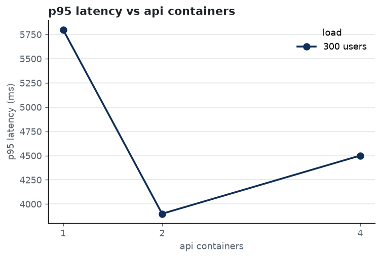

# Weather rain MLOps

Image classifier for four weather classes (cloudy, rainy, shiny, sunrise) that supports rain detection for a Rwanda climate use case. The model is a custom CNN trained from scratch (no transfer learning, no pretrained weights). The project covers the full MLOps loop: data audit, preprocessing, experiments, a prediction API, uploads and retraining with a trigger, a UI, Docker deployment on a cloud VM and a load test with Locust.

> **Model status:** the services run the final model `weather_cnn` (Section 7, seed 55 of `r0_patience30_min20`). On the locked test set, evaluated once: **macro F1 0.900** (95% CI 0.845 to 0.947), accuracy 0.903, rainy recall 0.966. Validation macro F1 is 0.962, which is optimistic because the seed was the best of 5 picked on validation. Full record: [models/metrics.json](models/metrics.json). See [The final model](#the-final-model).

Video demo: _link added in Section 14_. Live URL: _added after deployment_.

## Architecture

```
                 :80
  browser ──► nginx ──┬── /predict /health /uptime /model-info /docs ──► api  (x N, ONNX Runtime only)
                      ├── /trainer/...                                 ──► trainer (TensorFlow, 1 instance)
                      └── /  (Streamlit, websockets)                   ──► ui
  ./models  (bind mount) : api reads it, trainer writes it (atomic replace, the api hot-reloads)
  ./data    (bind mount) : train and valid images, uploads/<class>/, weather.db (SQLite)
```

- **api** ([app/api.py](app/api.py), [src/prediction.py](src/prediction.py)): loads the ONNX model with ONNX Runtime and preprocesses each image with the same function used in training ([src/preprocessing.py](src/preprocessing.py)). The image has no TensorFlow (a test checks this), so it is small and starts fast. It checks the model file on every request and reloads it when the trainer promotes a new one. Scale it with `--scale api=N`. Every response includes the container hostname, so you can see the load balancing.
- **trainer** ([app/trainer_api.py](app/trainer_api.py), [src/uploads.py](src/uploads.py), [src/database.py](src/database.py), [src/retrain.py](src/retrain.py)): uploads, SQLite records, retraining, metrics, data insights.
- **ui** ([app/ui.py](app/ui.py)): Streamlit with four pages: Predict, Insights, Upload and retrain, Monitoring.
- **nginx** ([docker/nginx.conf](docker/nginx.conf)): one public port. It resolves service names at request time (Docker DNS, `valid=10s`), so new api replicas are picked up without a restart.

## Repository structure

```
README.md
notebook/            weather_rain_classification.ipynb (Section 8), reads saved results, no GPU needed:
                     jupyter execute --inplace notebook/weather_rain_classification.ipynb
src/                 config, preprocessing, model, prediction, retrain, database, uploads, insights,
                     placeholder, onnx_export, metrics, experiments, grids, run_report, eda, audit
app/                 api.py, trainer_api.py, ui.py
data/                train/ valid/ test/ (images, in git), uploads/ (runtime, not in git)
models/              trained model files, archive/ (models replaced by a retrain)
experiments/         EXPERIMENT_LOG.md, FINDINGS.md, results.csv, figures, audit
docker/              Dockerfile.api, Dockerfile.trainer, Dockerfile.ui, nginx.conf
docker-compose.yml
locust/              locustfile.py, run_flood_test.sh, summarize.py, results/
tests/               pytest suite
colab/ kaggle/       GPU launcher notebooks for the training sections
requirements.txt     every package, pinned. Per service: requirements-api.txt, -trainer.txt, -ui.txt, -dev.txt
```

Dataset: Roboflow "weather classification" (folder export). 997 images after the Section 1 duplicate cleanup: train 719, valid 144, test 134. The cleaned images are committed in `data/train`, `data/valid` and `data/test`, one folder per class (about 37 MB). `data/quarantine/` (the removed duplicates) and `data/uploads/` (runtime uploads) are not committed.

## Run locally without Docker

```bash
python -m venv .venv && source .venv/bin/activate        # Windows: .venv\Scripts\activate
pip install -r requirements.txt
python -m src.placeholder                                 # placeholder model, only while no real model exists
uvicorn app.api:app --port 8000
uvicorn app.trainer_api:app --port 8001                   # second terminal
streamlit run app/ui.py                                   # third terminal, opens http://localhost:8501
python -m pytest -q tests
```

On Windows, use `http://127.0.0.1` rather than `http://localhost` for load tests. `localhost` tries IPv6 first and adds about 2 seconds to some new connections.

## Run with Docker

```bash
docker compose up -d --build
curl http://localhost/health
curl -F "file=@data/valid/rainy/<some image>.jpg" http://localhost/predict
docker compose up -d --scale api=4        # more prediction containers
```

- UI: `http://<host>/`. Prediction API docs: `http://<host>/docs`. Trainer API docs: `http://<host>/trainer/docs`.
- The model files are in the repository (`models/weather_cnn.h5`, `.onnx`, `class_names.json`, `metrics.json`), so the api is ready on first start. With `MODEL_NAME=placeholder_model` the trainer creates the placeholder files instead, and the api `/health` returns 503 until they exist.
- Settings (environment or a `.env` file next to the compose file): `MODEL_NAME`, `PUBLIC_PORT`, `PUBLIC_BASE_URL` (the address users open, used only for the UI sidebar links to `/docs`, `/health`, `/trainer/docs`, `/trainer/health` and `/trainer/retrain/status`; the compose default is `http://74.148.56.220`, include the port if `PUBLIC_PORT` is not 80, and leave it empty to hide the links), `API_CPUS` (CPU limit per api container, default 1), `RETRAIN_AUTO`, `RETRAIN_UPLOAD_THRESHOLD` (default 40), `RETRAIN_MAX_EPOCHS` (default 10), `MIN_FREE_DISK_MB` (default 500).

## Deployment on a cloud VM (step by step)

Platform: Docker on a Linux VM. Serverless platforms such as AWS Lambda are not used, because retraining needs a long-running process and local disk.

1. **Create the VM.** Ubuntu 24.04 LTS, at least 2 vCPU, 8 GB RAM (4 GB works with 1 or 2 api replicas) and a 30 GB disk. Give it a static public IP (AWS Elastic IP, GCP static external IP or Azure static public IP).
2. **Open the ports.** In the firewall or security group, allow inbound TCP 22 (SSH, your IP only) and TCP 80 (HTTP, everyone).
3. **Install Docker:**
   ```bash
   sudo apt-get update && sudo apt-get install -y ca-certificates curl git
   curl -fsSL https://get.docker.com | sudo sh
   sudo usermod -aG docker $USER && newgrp docker
   docker compose version
   ```
4. **Clone the repository:**
   ```bash
   git clone https://github.com/Flaviaa4/weather_rain_mlops.git && cd weather_rain_mlops
   ```
5. **Check the base images.** They are in git (`data/train`, `data/valid`, `data/test`, about 37 MB), so the clone already has them. Retraining needs `data/train` and `data/valid`: `curl http://<vm-ip>/trainer/health` (after step 6) shows `"base_data": {"ok": true, ...}` with the image counts, or `"status": "degraded"` and the missing path if they are absent.
6. **Start everything:** `docker compose up -d --build`. The first build downloads TensorFlow for the trainer image and takes a few minutes.
7. **Verify:** `curl http://<vm-ip>/health` returns `"status":"ok"`. Then open `http://<vm-ip>/` in a browser and predict one image.
8. **Start on boot:** `sudo systemctl enable docker`. Every service has `restart: always`, so the containers come back after a reboot. Test it with `sudo reboot`, then run step 7 again.
9. **Optional domain:** point a DNS A record at the static IP.

### Where ONNX Runtime is used, and why

- Training and retraining use TensorFlow/Keras, in the trainer container only. After each retrain, [src/onnx_export.py](src/onnx_export.py) converts the Keras model to ONNX with `tf2onnx.convert.from_keras`, with the SavedModel and `python -m tf2onnx.convert` command as a fallback. The trainer evaluates the ONNX file itself on the validation set, so the file it scores is the file that will be served.
- The api container runs that `.onnx` file with `onnxruntime` on CPU. The image needs no TensorFlow, so it is much smaller and starts faster. That makes running several replicas cheap.
- Promotion copies the new files next to the old ones and swaps them in with an atomic rename (`os.replace`). A request sees either the old model or the new one, never a half-written file. The api notices that the file changed and reloads it on the next request.

### Keep it running until grading is finished

- [ ] A billing alert is set at a low amount, and the account has enough credit for the grading period.
- [ ] Nobody stops or terminates the instance. Turn on termination protection if the cloud supports it.
- [ ] `restart: always` is set in the compose file, and Docker starts on boot (step 8).
- [ ] A disk usage alert is set at 80%. The trainer also refuses uploads when less than `MIN_FREE_DISK_MB` is free (HTTP 507 with a clear message).
- [ ] Daily health check: `curl -fsS http://<vm-ip>/health` from a cron job or an uptime monitor.
- [ ] A backup copy of `models/` and `data/weather.db` is saved off the server after every promoted retrain.

## Retraining and the trigger

1. Upload labelled images on the **Upload and retrain** page. You can upload several files with one class label, or a zip with one folder per class. Each file is validated (type, size, readable image), deduplicated by SHA-256, saved to `data/uploads/<class>/` and recorded in the `uploads` table in `data/weather.db`.
2. Retraining starts with the **Retrain now** button (`POST /trainer/retrain`). It also starts automatically when unused uploads reach `RETRAIN_UPLOAD_THRESHOLD` (default 40). Only one job runs at a time, and a second request gets HTTP 409.
3. The job loads our own saved Keras model (`models/<MODEL_NAME>.h5`), fine-tunes it at a low learning rate (1e-4) on the base train images plus all uploads, with the same preprocessing, augmentation and class weights as training, then exports it to ONNX.
4. **Promotion rule:** the new model replaces the served one only if its validation macro F1 is equal to or better than the current model's, measured on the same validation images. Before replacing anything, the old model is copied to `models/archive/<timestamp>_before_run<id>/`.
5. Every run is logged in the `training_runs` table: trigger, stage, duration, scores before and after, per-class F1, the promotion decision, and the error if it failed. If the trainer restarts during a run, that run is marked `interrupted`.

From a script: `docker compose exec trainer python -m src.retrain`.

## Flood test with Locust

```bash
pip install -r requirements-dev.txt
REPLICAS="1 2 4" USERS="10 50 100" DURATION=3m bash locust/run_flood_test.sh
```

For each api replica count, the script scales the api service and runs a 30 s warm-up that is discarded. It then runs a 3-minute measured run for each user count. It saves the Locust CSVs, the responses per container hostname and `docker stats`, and finally writes `locust/results/summary.md`, `summary.csv`, `latency_vs_replicas.png` and `throughput_vs_replicas.png`. The breaking point is the smallest user count where more than 1% of requests fail or p95 latency exceeds 2 s. The load is 90% `/predict` with validation images and 10% `/health`.

### Remote run: Locust in Azure Cloud Shell, scaling on the VM

The test sends only `POST /predict` (40 fixed validation images from `data/valid`, 90% of requests) and `GET /health` (10%). It never uploads or retrains, and `/predict` stores nothing (the api has no data volume and mounts `models/` read-only), so the training data and the uploads stay untouched.

1. On the VM: `docker compose up -d --scale api=N --no-recreate api nginx` (N = 1, 2, 4), wait 15 s.
2. In Azure Cloud Shell (clone the repo, then `pip install --user locust==2.47.0 pandas==2.2.3 matplotlib==3.10.0`):
   ```bash
   N=1; LOCUST_HOSTNAME_CSV=locust/results/r${N}_u300_rep1_hostnames.csv locust -f locust/locustfile.py --headless --host http://74.148.56.220 -u 300 -r 50 -t 60s --only-summary --csv locust/results/r${N}_u300_rep1 --html locust/results/r${N}_u300_rep1.html
   ```
3. After the three runs, download `locust/results` from Cloud Shell into the local repo and run `python locust/summarize.py locust/results`. It writes `summary.md`, `summary.csv` and two charts.
4. On the VM, restore the default: `docker compose up -d --scale api=1`.

### Results

VM: Azure Standard_B2s_v2 (2 vCPU, 8 GiB), Austria East. Date: 2026-11-25. Load: 300 users, spawn 50 per s, 60 s per run, generated from Azure Cloud Shell. Each api container has 1 CPU, 768 MiB and at most 8 concurrent predictions. Source: [locust/results/summary.md](locust/results/summary.md).

| api containers | users | requests/s | vs 1 container | median ms | p95 ms | failures | /predict responses per container |
|---|---|---|---|---|---|---|---|
| 1 | 300 | 53.3 | 1.00x | 4900 | 5800 | 0 of 3147 | 2817 |
| 2 | 300 | 93.6 | 1.76x | 1900 | 3900 | 0 of 5528 | 2510 / 2502 |
| 4 | 300 | 90.2 | 1.69x | 1800 | 4500 | 0 of 5329 | 1270 / 1223 / 1176 / 1173 |




Interpretation:

- **1 to 2 containers:** about 1.76x the throughput (53.3 to 93.6 requests/s), and the median latency drops from 4900 ms to 1900 ms.
- **2 to 4 containers:** no gain (93.6 to 90.2 requests/s, p95 4500 ms against 3900 ms). The VM has only 2 vCPU and each api container is limited to 1 CPU, so two containers already use all the cores. Four containers only share the same two cores. More containers need a bigger VM.
- **Balancing:** nginx spreads the requests evenly. The per-container counts differ by less than 1% with 2 containers and by about 8% at most with 4.
- **Failures:** 0 in all three runs after the memory fix (see the incident below).
- **Latency:** high at 300 users because requests queue behind the cap of 8 concurrent predictions per container. With the 2 s p95 rule, every configuration is past its breaking point at 300 users. The cap trades latency for stability: requests wait instead of the container running out of memory.
- **Earlier runs not used:** the first runs (50 users from a home PC) were dominated by the network latency to Austria East (p95 14 to 20 s at under 6 requests/s), so they are not in the table. Their files are kept in `locust/results/home_pc_u50/`. The load generator runs in Azure Cloud Shell instead.

### Incident: OOM kill at 300 users with 1 container

The first N=1 runs at 300 concurrent users crashed the api container. The kernel log showed `Memory cgroup out of memory: Killed process uvicorn` with anon-rss about 494 MB against the 512 MiB limit. Docker restarted the container 19 times and nginx returned 502 while it was down. Every waiting request had its image read and decoded at the same time, so memory grew with the number of users.

Fix:

1. The api memory limit is now 768 MiB (cpus stays 1.0). 4 api replicas (3 GiB) plus the 3 GiB trainer still fit in the 8 GiB VM, so do not raise it further.
2. `/predict` runs at most `MAX_CONCURRENT_PREDICTIONS` predictions at once per container (default 8). Extra requests wait in the event loop without holding a thread or a decoded image, so memory per container is bounded. Under heavy load they show up as higher latency (or a 504 after nginx's 60 s timeout) instead of a crash.
3. `/health` is outside the cap and uses the normal thread pool, so health checks never wait behind predictions.
4. Uploads larger than `MAX_UPLOAD_MB` (10 MB) are rejected with 413 from the `Content-Length` header, before the file is read or decoded.

Rerun the N=1 test after `docker compose up -d --build api` on the VM, and check `docker inspect --format '{{.RestartCount}}'` on the api container stays at 0.

## The final model

All model paths come from `MODEL_NAME` in [src/config.py](src/config.py):

```python
MODEL_NAME = os.environ.get("MODEL_NAME", "weather_cnn")
```

The final model is trained on Kaggle by Section 7 (`SECTION = 7`, `GROUP = "smoke,final"` in [kaggle/run_section.ipynb](kaggle/run_section.ipynb)). The group writes `weather_cnn.h5`, `weather_cnn.onnx`, `metrics.json` (with `validation` and `test` keys) and `class_names.json` to `experiments/final_model/` inside the results zip. Install them with:

```bash
python -m src.final_model --install experiments/incoming/section7
```

The install step checks that the ONNX file is the one the test set was evaluated with, that ONNX parity passed, and that the ONNX model reproduces the recorded validation macro F1 on `data/valid`. Then it copies the four files into `models/`, where the api and the trainer read them. The copy in `experiments/final_model/` (with `test_touch.json` and the test predictions) stays as the record of the single test evaluation. A promoted retrain replaces the files in `models/` (the previous ones go to `models/archive/`), so `models/metrics.json` then holds the retrain record. Set `MODEL_NAME=placeholder_model` in `.env` only to test the services without the trained model.

### Known false positive: fireworks predicted as rainy

A photo of fireworks was classified as **rainy**. This is expected behaviour, not a bug in the API or the pipeline. The model knows only four classes (cloudy, rainy, shiny, sunrise) and has no "other" or "not a sky photo" class, so its softmax output always picks one of the four, even for an image unlike anything in the training data. A dark sky with bright falling streaks is closest to the rainy training images. The UI shows a low-confidence warning below 60%, but an image outside the training data can still get a high score, so the warning does not catch every case like this. Possible fixes are an extra "other" class trained on non-weather images, or an out-of-distribution check before the prediction is shown.
