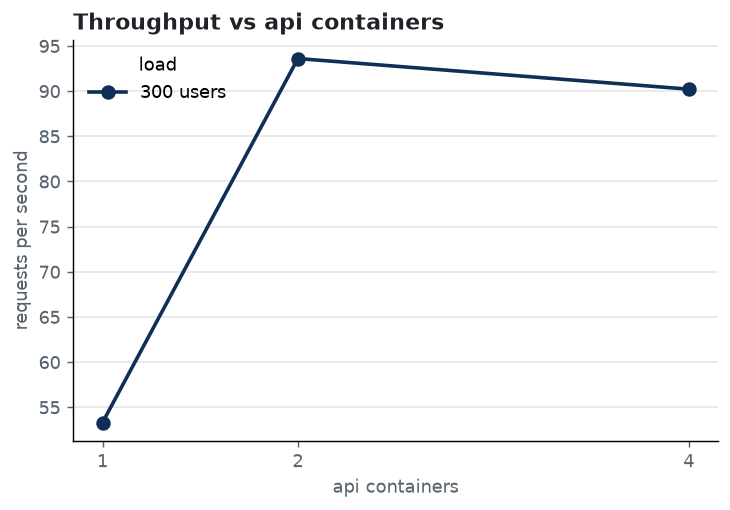

# Weather rain MLOps

Image classifier for four weather classes (cloudy, rainy, shiny, sunrise) that supports rain detection for a Rwanda climate use case. The model is a custom CNN trained from scratch (no transfer learning, no pretrained weights). The project covers the full MLOps loop: data audit, preprocessing, experiments, a prediction API, uploads and retraining with a trigger, a UI, Docker deployment on a cloud VM and a load test with Locust.

> **Model status:** the services run the final model `weather_cnn` (Section 7, seed 55 of `r0_patience30_min20`). On the locked test set, evaluated once: **macro F1 0.900** (95% CI 0.845 to 0.947), accuracy 0.903, rainy recall 0.966. Validation macro F1 is 0.962, which is optimistic because the seed was the best of 5 picked on validation. Full record: [models/metrics.json](models/metrics.json). See [The final model](#the-final-model).

Video demo: https://www.youtube.com/watch?v=H0xv6HVNI90. Live URL: http://74.148.56.220 .

## Architecture

```
                 :80
  browser ──► nginx ──┬── /predict /health /uptime /model-info /docs ──► api  (x N, ONNX Runtime only)
                      ├── /trainer/...                                 ──► trainer (TensorFlow, 1 instance)
                      └── /  (Streamlit, websockets)                   ──► ui
  ./models  (bind mount) : api reads it, trainer writes it (atomic replace, the api hot-reloads)
  ./data    (bind mount) : train and valid images, uploads/<class>/, weather.db (SQLite)
```

- **api** ([app/api.py](app/api.py), [src/prediction.py](src/prediction.py)): loads the ONNX model with ONNX Runtime and preprocesses each image with the same function used in training ([src/preprocessing.py](src/preprocessing.py)). The image has no TensorFlow (a test checks the api code never imports it), so it is small and starts fast. It checks the model file on every request and reloads it when the trainer promotes a new one. Scale it with `--scale api=N`. Every response includes the container hostname, so you can see the load balancing.
- **trainer** ([app/trainer_api.py](app/trainer_api.py), [src/uploads.py](src/uploads.py), [src/database.py](src/database.py), [src/retrain.py](src/retrain.py)): uploads, SQLite records, retraining, metrics, data insights.
- **ui** ([app/ui.py](app/ui.py)): Streamlit with four pages: Predict, Insights, Upload and retrain, Monitoring.
- **nginx** ([docker/nginx.conf](docker/nginx.conf)): one public port. It resolves service names at request time (Docker DNS, `valid=10s`), so new api replicas are picked up without a restart.

## Repository structure

```
README.md
notebook/            weather_rain_classification.ipynb (Section 8), reads saved results, no GPU needed:
                     jupyter execute --inplace notebook/weather_rain_classification.ipynb
src/                 config, preprocessing, model, prediction, retrain, database, uploads, insights,
                     placeholder, onnx_export, metrics, experiments, grids, run_report, eda, audit
app/                 api.py, trainer_api.py, ui.py
data/                train/ valid/ test/ (images, in git), uploads/ (runtime, not in git)
models/              trained model files, archive/ (models replaced by a retrain)
experiments/         EXPERIMENT_LOG.md, FINDINGS.md, results.csv, figures, audit
docker/              Dockerfile.api, Dockerfile.trainer, Dockerfile.ui, nginx.conf
docker-compose.yml
locust/              locustfile.py, run_flood_test.sh, summarize.py, results/
tests/               pytest suite
colab/ kaggle/       GPU launcher notebooks for the training sections
requirements.txt     every package, pinned. Per service: requirements-api.txt, -trainer.txt, -ui.txt, -dev.txt
```

Dataset: Roboflow "weather classification" (folder export). 997 images after the Section 1 duplicate cleanup: train 719, valid 144, test 134. The cleaned images are committed in `data/train`, `data/valid` and `data/test`, one folder per class (about 37 MB). `data/quarantine/` (the removed duplicates) and `data/uploads/` (runtime uploads) are not committed.

## Code structure

The pipeline is split into small single-purpose functions. The `.py` files in `src/` and `app/` hold 599 function definitions (nested ones included), and none is longer than 20 lines. This count covers only `src/` and `app/`; `tests/`, `locust/` and the notebooks are not included. Orchestrator functions (`run_one`, `run_retraining`, `run_final`) only call the steps below in order.

| Pipeline stage | Functions |
|---|---|
| Data loading | `preprocessing.list_labeled_files`, `preprocessing.load_split`, `experiments.prepare_data` |
| Preprocessing | `preprocessing.preprocess_image` = `to_rgb` then `resize_image` then `to_array` then `normalize_array`; `augment_image`, `build_dataset` |
| Model building | `model.build_cnn` from `conv_unit`, `conv_block`, `classifier_head`; `compile_model`, `get_callbacks` |
| Training | `model.train_model`, `model.compute_class_weights`, `experiments.fit_run`, `experiments.run_one` |
| Evaluation | `metrics.classification_metrics`, `metrics.per_class_scores`, `model.evaluate_model`, `prediction.evaluate_onnx_model` |
| Export | `onnx_export.export_keras_to_onnx` from `convert` (`export_with_from_keras`, fallback `export_with_saved_model`) and `add_metadata`; `final_model.check_parity` |
| Prediction | `prediction.predict_image_bytes` = `validate_image_bytes` then `preprocess_image_bytes` then `predict_array` (`get_session`, `run_inference`, `format_prediction`) |
| Retraining | `retrain.check_base_data`, `prepare_retraining_data`, `fine_tune_model`, `export_candidate`, `evaluate_model_file`, `run_retraining` |
| Promotion rule | `retrain.should_promote` (candidate macro F1 at least the current one), `decide_and_apply`, `archive_current_model`, `promote_model`, `atomic_replace` |

Modules and their single job:

| Module | Job | Main functions |
|---|---|---|
| [src/config.py](src/config.py) | Paths and settings from environment variables | `env_path`, `env_int`, `env_float` |
| [src/preprocessing.py](src/preprocessing.py) | Image loading, resizing, normalisation, augmentation, tf.data datasets | `load_split`, `preprocess_image`, `augment_image`, `build_dataset` |
| [src/model.py](src/model.py) | CNN definition, compile, callbacks, training, class weights | `build_cnn`, `compile_model`, `get_callbacks`, `train_model`, `evaluate_model` |
| [src/metrics.py](src/metrics.py) | Confusion matrix and classification metrics without sklearn | `confusion_matrix`, `per_class_scores`, `classification_metrics` |
| [src/onnx_export.py](src/onnx_export.py) | Keras to ONNX conversion | `export_keras_to_onnx`, `convert` |
| [src/prediction.py](src/prediction.py) | ONNX Runtime session cache, input validation, prediction | `get_session`, `validate_image_bytes`, `predict_image_bytes`, `model_version` |
| [src/retrain.py](src/retrain.py) | Retraining job and the promotion rule | `run_retraining`, `fine_tune_model`, `should_promote`, `promote_model`, `maybe_auto_retrain` |
| [src/uploads.py](src/uploads.py) | Saving uploaded images and zips, disk check | `save_uploads`, `save_zip_uploads`, `check_disk_space` |
| [src/database.py](src/database.py) | SQLite records of uploads and training runs | `init_db`, `add_upload`, `start_run`, `update_run`, `list_runs` |
| [src/insights.py](src/insights.py) | Image features and class separation for the Insights page | `extract_features`, `auc_table`, `insight_payload` |
| [src/experiments.py](src/experiments.py) | Resumable experiment grids for the training sections | `run_one`, `run_grid`, `run_section`, `estimate_section` |
| [src/grids.py](src/grids.py) | Experiment configurations per section | `section_groups`, `final_config` |
| [src/selection.py](src/selection.py) | Picking the configuration from multi-seed results | `summarize_group`, `select_config` |
| [src/final_model.py](src/final_model.py) | Final training, single test evaluation, parity, install | `run_final`, `check_parity`, `evaluate_test_once`, `install_final_model` |
| [src/run_report.py](src/run_report.py) | Per-run curves, confusion matrix and predictions files | `plot_curves`, `plot_confusion_matrix`, `save_predictions` |
| [src/audit.py](src/audit.py), [src/audit_visuals.py](src/audit_visuals.py) | Dataset audit and duplicate quarantine | `scan_dataset`, `build_duplicate_groups`, `apply_quarantine` |
| [src/eda.py](src/eda.py) | EDA figures and the image size experiment | `run_eda`, `run_size_experiment` |
| [src/chance_band.py](src/chance_band.py), [src/diagnostics.py](src/diagnostics.py) | Chance-level baselines and training diagnostics | `build_chance_band`, `run_batch_diagnostics` |
| [src/check_env.py](src/check_env.py) | Colab and Kaggle environment and export check | `run_checks` |
| [src/placeholder.py](src/placeholder.py) | Placeholder model for testing without the trained model | `ensure_placeholder_files` |
| [src/notebook_views.py](src/notebook_views.py) | Tables and figures for the notebook | `load_results`, `final_overview`, `parity_table` |
| [app/api.py](app/api.py) | Prediction API | `predict`, `limited_predict`, `health`, `model_info` |
| [app/trainer_api.py](app/trainer_api.py) | Upload, retrain, metrics and insights API | `upload`, `upload_zip`, `start_retrain`, `retrain_status`, `health` |
| [app/ui.py](app/ui.py) | Streamlit UI, one function per page and widget | `page_predict`, `page_insights`, `page_retrain`, `page_monitoring` |

## Run locally without Docker

```bash
python -m venv .venv && source .venv/bin/activate        # Windows: .venv\Scripts\activate
pip install -r requirements.txt
python -m src.placeholder                                 # placeholder model, only while no real model exists
uvicorn app.api:app --port 8000
uvicorn app.trainer_api:app --port 8001                   # second terminal
streamlit run app/ui.py                                   # third terminal, opens http://localhost:8501
python -m pytest -q tests
```

On Windows, use `http://127.0.0.1` rather than `http://localhost` for load tests. `localhost` tries IPv6 first and adds about 2 seconds to some new connections.

## Run with Docker

```bash
docker compose up -d --build
curl http://localhost/health
curl -F "file=@data/valid/rainy/<some image>.jpg" http://localhost/predict
docker compose up -d --scale api=4        # more prediction containers
```

- UI: `http://<host>/`. Prediction API docs: `http://<host>/docs`. Trainer API docs: `http://<host>/trainer/docs`.
- The model files are in the repository (`models/weather_cnn.h5`, `.onnx`, `class_names.json`, `metrics.json`), so the api is ready on first start. With `MODEL_NAME=placeholder_model` the trainer creates the placeholder files instead, and the api `/health` returns 503 until they exist.
- Settings (environment or a `.env` file next to the compose file): `MODEL_NAME`, `PUBLIC_PORT`, `PUBLIC_BASE_URL` (the address users open, used only for the UI sidebar links to `/docs`, `/health`, `/trainer/docs`, `/trainer/health` and `/trainer/retrain/status`; the compose default is `http://74.148.56.220`, include the port if `PUBLIC_PORT` is not 80, and leave it empty to hide the links), `API_CPUS` (CPU limit per api container, default 1), `RETRAIN_AUTO`, `RETRAIN_UPLOAD_THRESHOLD` (default 40), `RETRAIN_MAX_EPOCHS` (default 10), `MIN_FREE_DISK_MB` (default 500).

## Deployment guide

This is how the live app at **http://74.148.56.220** was deployed. A grader can repeat it on a new VM, or check the running one with step 6.

**Model:** the served model is a custom CNN trained from scratch (3 convolution blocks of 2 conv layers with 32, 64 and 128 filters, batch norm, global average pooling, dropout 0.3, a 128-unit dense layer and a 4-class softmax). It uses no transfer learning and no pretrained weights. Retraining starts from our own saved `models/weather_cnn.h5`.

### Requirements

| Item | Value |
|---|---|
| VM | Azure Standard_B2s_v2 (2 vCPU, 8 GiB RAM), region Austria East |
| OS and disk | Ubuntu 24.04 LTS, 30 GB disk |
| Public IP | static, 74.148.56.220 |
| Inbound ports | 22 (SSH) and 80 (HTTP), opened with network security group rules |
| Software | Docker 29 and Docker Compose v5, installed with the get.docker.com script |

The dataset (`data/train`, `data/valid`, `data/test`, about 37 MB) and the model files (`models/weather_cnn.h5`, `weather_cnn.onnx`, `class_names.json`, `metrics.json`) are in the repository, so nothing else has to be downloaded.

### Steps

1. **Create the VM.** In the Azure portal: Ubuntu Server 24.04 LTS, size Standard_B2s_v2, region Austria East, 30 GB OS disk, administrator account `azureuser` with password authentication. Set the public IP address to **Static** so it does not change when the VM restarts.
2. **Open the ports.** In the VM's network security group, add inbound rules for TCP 22 (SSH) and TCP 80 (HTTP).
3. **SSH in:** `ssh azureuser@74.148.56.220` and enter the admin password. Optional hardening, not used for this deployment: switch to SSH key login, disable password login, and limit the port 22 rule to your own IP.
4. **Install Docker:**
   ```bash
   curl -fsSL https://get.docker.com | sudo sh
   sudo usermod -aG docker $USER && newgrp docker
   docker --version && docker compose version
   ```
5. **Clone and start:**
   ```bash
   git clone https://github.com/Flaviaa4/weather_rain_mlops.git && cd weather_rain_mlops
   docker compose up -d --build
   docker compose ps
   ```
   The first build takes a few minutes because the trainer image installs TensorFlow.
6. **Health check:**
   ```bash
   curl http://74.148.56.220/health                 # api: "status": "ok", model weather_cnn
   curl -I http://74.148.56.220/docs                # api Swagger page: HTTP 200
   curl http://74.148.56.220/trainer/health         # trainer: "status": "ok", "base_data": {"ok": true, ...}
   IMG=$(ls data/valid/rainy/*.jpg | head -1)
   curl -F "file=@$IMG" http://74.148.56.220/predict
   ```
   Then open http://74.148.56.220/ for the UI.
7. **Scale the api:**
   ```bash
   docker compose up -d --scale api=N               # N = 1, 2 or 4
   docker compose restart nginx
   docker compose ps api
   ```
   Each `/predict` response has a `hostname` field (the container ID, shown in the UI as "Served by container"). Repeated requests show N different values. Restore with `docker compose up -d --scale api=1` and `docker compose restart nginx`.
8. **Update after a push to GitHub:**
   ```bash
   cd ~/weather_rain_mlops && git pull
   docker compose up -d --build
   ```
   Compose recreates only the containers whose image or settings changed. Add `--scale api=N` to keep more than one api container. nginx reads `docker/nginx.conf` from a bind mount, so after a change to that file also run `docker compose restart nginx`. `data/uploads/`, `data/weather.db` and `models/` are bind mounts too, so uploads, run history and a promoted model survive the rebuild.
9. **Keep it up until grading is finished:**
   - Every service has `restart: always`, and Docker starts on boot, so the containers come back after a crash or a VM reboot (`sudo systemctl is-enabled docker` prints `enabled`).
   - The public IP is static, so the URL stays the same.
   - Do not stop or deallocate the VM in the Azure portal, and keep auto-shutdown off.

### ONNX Runtime

- **Export:** after training, [src/onnx_export.py](src/onnx_export.py) converts the Keras model with `tf2onnx.convert.from_keras` (input `image`, shape `(None, 128, 128, 3)`, output `probabilities`). If that fails it falls back to a SavedModel export and `python -m tf2onnx.convert --saved-model`. The final model was exported with `from_keras`. A retrain exports its candidate the same way.
- **Parity check:** [src/final_model.py](src/final_model.py) reloads the `.h5` on CPU and compares Keras and ONNX Runtime probabilities image by image. Maximum absolute difference: 5.1e-7 on the 144 validation images and **1.4e-6** on the 134 test images, against a tolerance of 1e-4, with the same predicted class on 100% of images (recorded under `parity` in [models/metrics.json](models/metrics.json)).
- **Serving:** the api ([src/prediction.py](src/prediction.py)) runs `models/weather_cnn.onnx` with `onnxruntime` on CPU (`ONNX_THREADS=1` per container). It keeps one session in memory and reloads it when the file on disk changes, for example after a promoted retrain.
- **Why ONNX:** ONNX Runtime is a small inference-only runtime, so the api image needs no TensorFlow at all (`requirements-api.txt` does not list it, and a test checks that the api code never imports it). The image is smaller, the containers start faster, and running several replicas is cheap. Inference also skips the TensorFlow and Keras layers, which keeps per-request CPU time low on a 2 vCPU VM.

### Architecture

nginx listens on port 80 and is the only public entry point ([docker/nginx.conf](docker/nginx.conf)):

| Path | Service | Job |
|---|---|---|
| `/predict`, `/health`, `/uptime`, `/model-info`, `/docs`, `/redoc`, `/openapi.json` | **api** ([app/api.py](app/api.py)) | ONNX predictions and model info. Scalable to N containers. |
| `/trainer/...` | **trainer** ([app/trainer_api.py](app/trainer_api.py)) | Uploads, SQLite records, retraining, metrics, data insights, disk report (`/trainer/system`). One container, with TensorFlow. |
| `/` | **ui** ([app/ui.py](app/ui.py)) | Streamlit pages Predict, Insights, Upload and retrain, Monitoring. Calls the api and the trainer through nginx. |

nginx resolves the service names through Docker DNS (`valid=10s`) and spreads requests over the api containers.

Environment variables (set them in a `.env` file next to `docker-compose.yml`, then run `docker compose up -d`):

| Variable | Service | Default | What it does |
|---|---|---|---|
| `MODEL_NAME` | api, trainer | `weather_cnn` | Which files in `models/` are served and retrained (`<MODEL_NAME>.onnx`, `.h5`). `placeholder_model` is only for testing without the trained model. |
| `MAX_CONCURRENT_PREDICTIONS` | api | `8` | Maximum predictions running at once per api container. Extra requests wait instead of using more memory. |
| `RETRAIN_MAX_EPOCHS` | trainer | `10` | Maximum fine-tuning epochs per retrain (early stopping can end it sooner). |
| `PUBLIC_BASE_URL` | ui | `http://74.148.56.220` | Address used only for the sidebar links (`/docs`, `/health`, `/trainer/docs`, `/trainer/health`, `/trainer/retrain/status`). Empty hides the links. The UI still calls the services through the internal `http://nginx` address. |

Other settings: `PUBLIC_PORT` (default 80), `API_CPUS` (default 1.0), `RETRAIN_AUTO` (default 1), `RETRAIN_UPLOAD_THRESHOLD` (default 40), `MIN_FREE_DISK_MB` (default 500).

### Capacity

Resource limits per container ([docker-compose.yml](docker-compose.yml)):

| Service | CPU | Memory |
|---|---|---|
| api (each replica) | 1.0 | 768 MiB |
| trainer | no limit | 3 GiB |
| ui, nginx | no limit | no limit |

4 api replicas (3 GiB) plus the trainer (3 GiB) leave about 2 GiB of the 8 GiB for the ui, nginx and the OS. With 2 vCPU, more than 2 api containers add no throughput (see the flood test results).

Disk use:

- **Uploads:** saved to `data/uploads/<class>/`, at most 10 MB per file (`MAX_UPLOAD_MB`), deduplicated by SHA-256. The trainer refuses uploads with HTTP 507 when less than `MIN_FREE_DISK_MB` (500 MB) is free.
- **Retrain runs:** each run writes a candidate model to `models/candidate/run_<id>/` (about 2.5 MB) and deletes it when the run ends. A promoted run first copies the current model to `models/archive/<timestamp>_before_run<id>/` (about 2.5 MB each, kept). Run records go to the small SQLite file `data/weather.db`.
- **Docker images:** the trainer image is by far the largest because of TensorFlow. Check sizes with `docker system df`, and free disk with `df -h /` or `curl http://74.148.56.220/trainer/system`.

To free space:

```bash
docker system prune          # stopped containers, unused networks, dangling images, build cache
docker builder prune         # build cache only
```

Both keep `data/` and `models/`, which are bind mounts in the repository folder. `docker system prune -a` also removes unused images, so the next `docker compose up -d --build` downloads and builds them again. Old folders in `models/archive/` can be deleted by hand when they are no longer needed.

## Retraining and the trigger

1. Upload labelled images on the **Upload and retrain** page. You can upload several files with one class label, or a zip with one folder per class. Each file is validated (type, size, readable image), deduplicated by SHA-256, saved to `data/uploads/<class>/` and recorded in the `uploads` table in `data/weather.db`.
2. Retraining starts with the **Retrain now** button (`POST /trainer/retrain`). It also starts automatically when unused uploads reach `RETRAIN_UPLOAD_THRESHOLD` (default 40). Only one job runs at a time, and a second request gets HTTP 409.
3. The job loads our own saved Keras model (`models/<MODEL_NAME>.h5`), fine-tunes it at a low learning rate (1e-4) on the base train images plus all uploads, with the same preprocessing, augmentation and class weights as training, then exports it to ONNX.
4. **Promotion rule:** the new model replaces the served one only if its validation macro F1 is equal to or better than the current model's, measured on the same validation images. Before replacing anything, the old model is copied to `models/archive/<timestamp>_before_run<id>/`.
5. Every run is logged in the `training_runs` table: trigger, stage, duration, scores before and after, per-class F1, the promotion decision, and the error if it failed. If the trainer restarts during a run, that run is marked `interrupted`.

From a script: `docker compose exec trainer python -m src.retrain`.

## Flood test with Locust

```bash
pip install -r requirements-dev.txt
REPLICAS="1 2 4" USERS="10 50 100" DURATION=3m bash locust/run_flood_test.sh
```

For each api replica count, the script scales the api service and runs a 30 s warm-up that is discarded. It then runs a 3-minute measured run for each user count. It saves the Locust CSVs, the responses per container hostname and `docker stats`, and finally writes `locust/results/summary.md`, `summary.csv`, `latency_vs_replicas.png` and `throughput_vs_replicas.png`. The breaking point is the smallest user count where more than 1% of requests fail or p95 latency exceeds 2 s. The load is 90% `/predict` with validation images and 10% `/health`.

### Remote run: Locust in Azure Cloud Shell, scaling on the VM

The test sends only `POST /predict` (40 fixed validation images from `data/valid`, 90% of requests) and `GET /health` (10%). It never uploads or retrains, and `/predict` stores nothing (the api has no data volume and mounts `models/` read-only), so the training data and the uploads stay untouched.

1. On the VM: `docker compose up -d --scale api=N --no-recreate api nginx` (N = 1, 2, 4), wait 15 s.
2. In Azure Cloud Shell (clone the repo, then `pip install --user locust==2.47.0 pandas==2.2.3 matplotlib==3.10.0`):
   ```bash
   N=1; LOCUST_HOSTNAME_CSV=locust/results/r${N}_u300_rep1_hostnames.csv locust -f locust/locustfile.py --headless --host http://74.148.56.220 -u 300 -r 50 -t 60s --only-summary --csv locust/results/r${N}_u300_rep1 --html locust/results/r${N}_u300_rep1.html
   ```
3. After the three runs, download `locust/results` from Cloud Shell into the local repo and run `python locust/summarize.py locust/results`. It writes `summary.md`, `summary.csv` and two charts.
4. On the VM, restore the default: `docker compose up -d --scale api=1`.

### Results

VM: Azure Standard_B2s_v2 (2 vCPU, 8 GiB), Austria East. Date: 2026-11-25. Load: 300 users, spawn 50 per s, 60 s per run, generated from Azure Cloud Shell. Each api container has 1 CPU, 768 MiB and at most 8 concurrent predictions. Source: [locust/results/summary.md](locust/results/summary.md).

| api containers | users | requests/s | vs 1 container | median ms | p95 ms | failures | /predict responses per container |
|---|---|---|---|---|---|---|---|
| 1 | 300 | 53.3 | 1.00x | 4900 | 5800 | 0 of 3147 | 2817 |
| 2 | 300 | 93.6 | 1.76x | 1900 | 3900 | 0 of 5528 | 2510 / 2502 |
| 4 | 300 | 90.2 | 1.69x | 1800 | 4500 | 0 of 5329 | 1270 / 1223 / 1176 / 1173 |




Interpretation:

- **1 to 2 containers:** about 1.76x the throughput (53.3 to 93.6 requests/s), and the median latency drops from 4900 ms to 1900 ms.
- **2 to 4 containers:** no gain (93.6 to 90.2 requests/s, p95 4500 ms against 3900 ms). The VM has only 2 vCPU and each api container is limited to 1 CPU, so two containers already use all the cores. Four containers only share the same two cores. More containers need a bigger VM.
- **Balancing:** nginx spreads the requests evenly. The per-container counts differ by less than 1% with 2 containers and by about 8% at most with 4.
- **Failures:** 0 in all three runs after the memory fix (see the incident below).
- **Latency:** high at 300 users because requests queue behind the cap of 8 concurrent predictions per container. With the 2 s p95 rule, every configuration is past its breaking point at 300 users. The cap trades latency for stability: requests wait instead of the container running out of memory.
- **Earlier runs not used:** the first runs (50 users from a home PC) were dominated by the network latency to Austria East (p95 14 to 20 s at under 6 requests/s), so they are not in the table. Their files are kept in `locust/results/home_pc_u50/`. The load generator runs in Azure Cloud Shell instead.

### Incident: OOM kill at 300 users with 1 container

The first N=1 runs at 300 concurrent users crashed the api container. The kernel log showed `Memory cgroup out of memory: Killed process uvicorn` with anon-rss about 494 MB against the 512 MiB limit. Docker restarted the container 19 times and nginx returned 502 while it was down. Every waiting request had its image read and decoded at the same time, so memory grew with the number of users.

Fix:

1. The api memory limit is now 768 MiB (cpus stays 1.0). 4 api replicas (3 GiB) plus the 3 GiB trainer still fit in the 8 GiB VM, so do not raise it further.
2. `/predict` runs at most `MAX_CONCURRENT_PREDICTIONS` predictions at once per container (default 8). Extra requests wait in the event loop without holding a thread or a decoded image, so memory per container is bounded. Under heavy load they show up as higher latency (or a 504 after nginx's 60 s timeout) instead of a crash.
3. `/health` is outside the cap and uses the normal thread pool, so health checks never wait behind predictions.
4. Uploads larger than `MAX_UPLOAD_MB` (10 MB) are rejected with 413 from the `Content-Length` header, before the file is read or decoded.

Rerun the N=1 test after `docker compose up -d --build api` on the VM, and check `docker inspect --format '{{.RestartCount}}'` on the api container stays at 0.

## The final model

All model paths come from `MODEL_NAME` in [src/config.py](src/config.py):

```python
MODEL_NAME = os.environ.get("MODEL_NAME", "weather_cnn")
```

The final model is trained on Kaggle by Section 7 (`SECTION = 7`, `GROUP = "smoke,final"` in [kaggle/run_section.ipynb](kaggle/run_section.ipynb)). The group writes `weather_cnn.h5`, `weather_cnn.onnx`, `metrics.json` (with `validation` and `test` keys) and `class_names.json` to `experiments/final_model/` inside the results zip. Install them with:

```bash
python -m src.final_model --install experiments/incoming/section7
```

The install step checks that the ONNX file is the one the test set was evaluated with, that ONNX parity passed, and that the ONNX model reproduces the recorded validation macro F1 on `data/valid`. Then it copies the four files into `models/`, where the api and the trainer read them. The copy in `experiments/final_model/` (with `test_touch.json` and the test predictions) stays as the record of the single test evaluation. A promoted retrain replaces the files in `models/` (the previous ones go to `models/archive/`), so `models/metrics.json` then holds the retrain record. Set `MODEL_NAME=placeholder_model` in `.env` only to test the services without the trained model.

### Known false positive: fireworks predicted as rainy

A photo of fireworks was classified as **rainy**. This is expected behaviour, not a bug in the API or the pipeline. The model knows only four classes (cloudy, rainy, shiny, sunrise) and has no "other" or "not a sky photo" class, so its softmax output always picks one of the four, even for an image unlike anything in the training data. A dark sky with bright falling streaks is closest to the rainy training images. The UI shows a low-confidence warning below 60%, but an image outside the training data can still get a high score, so the warning does not catch every case like this. Possible fixes are an extra "other" class trained on non-weather images, or an out-of-distribution check before the prediction is shown.
